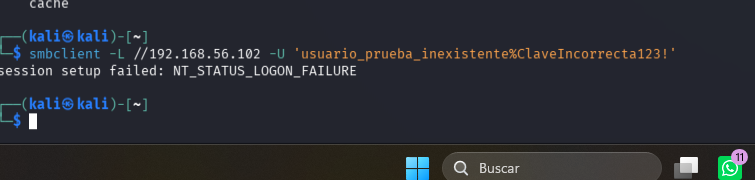
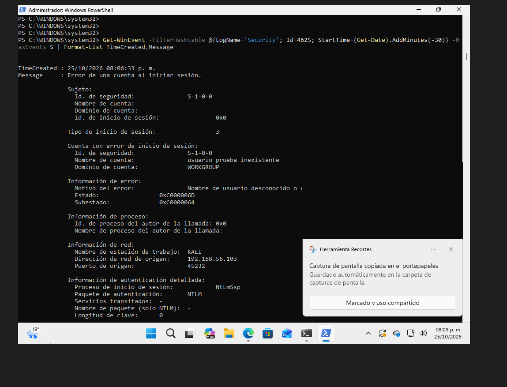
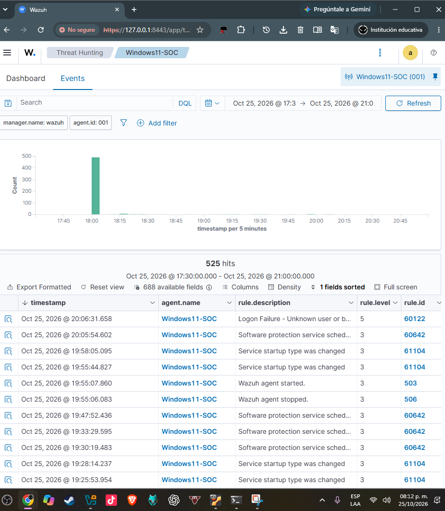
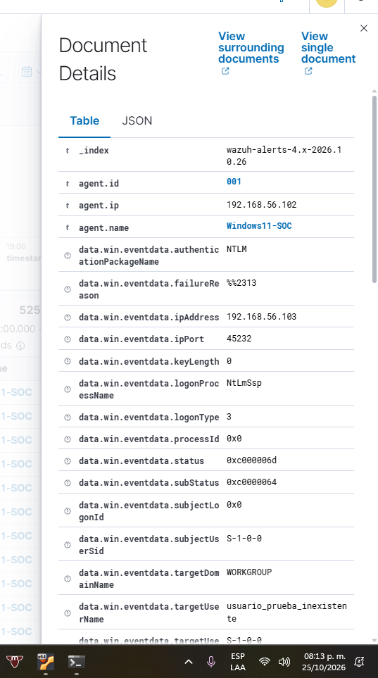
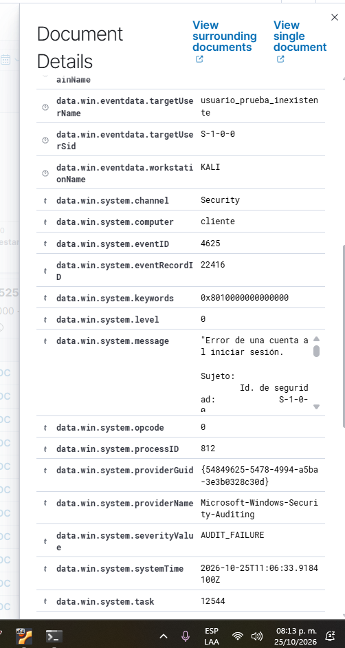

# Mini SOC — Detección de autenticación SMB fallida con Wazuh

Laboratorio práctico **Purple Team** con **Kali Linux**, **Windows 11**, **Wazuh** y **VirtualBox**. Se simuló **un intento controlado de autenticación SMB con credenciales ficticias**, y se confirmó la trazabilidad desde el comando ofensivo hasta una alerta en el SIEM.

> **Alcance:** máquinas virtuales propias, en red privada de laboratorio. No se realizó explotación, acceso exitoso ni fuerza bruta. Las IP mostradas son direcciones privadas del entorno de práctica.

## Resultado destacado

| Indicador | Resultado observado |
|---|---|
| Fecha de prueba | 25 de octubre de 2026 |
| Origen del intento | Kali Linux — `192.168.56.103` |
| Equipo destino | Windows 11 — `192.168.56.102` |
| SIEM / manager | Wazuh en Ubuntu — `192.168.56.101` (topología del laboratorio) |
| Servicio | SMB (`445/TCP`) |
| Respuesta del cliente | `NT_STATUS_LOGON_FAILURE` |
| Registro de Windows | Security, **Event ID 4625**, inicio de sesión tipo **3** (red) |
| Cuenta de prueba | `usuario_prueba_inexistente` |
| Autenticación | **NTLM** |
| Estado / subestado | `0xC000006D` / `0xC0000064` (autenticación fallida / usuario inexistente) |
| Detección Wazuh | **Rule ID 60122**, nivel **5**, “Logon Failure - Unknown user or bad password” |

## Arquitectura del laboratorio

```text
[Kali Linux] 192.168.56.103
     | Intento SMB (credenciales ficticias)
     v
[Windows 11] 192.168.56.102
     | Windows Security — evento 4625
     v
[Agente Wazuh] -----> [Wazuh Manager + Dashboard / Ubuntu] 192.168.56.101
                                 | regla 60122, nivel 5
                                 v
                          Alerta visible
```

## Procedimiento reproducible

1. Encender las tres máquinas virtuales y verificar conectividad dentro de la red privada.
2. Comprobar que el servicio SMB del Windows de prueba esté accesible **solo desde el laboratorio**.
3. Desde **Kali** ejecutar **una vez** el siguiente intento de autenticación de prueba:

   ```bash
   smbclient -L //192.168.56.102 -U 'usuario_prueba_inexistente%ClaveIncorrecta123!'
   ```

4. Registrar la respuesta `session setup failed: NT_STATUS_LOGON_FAILURE`.
5. En **PowerShell como administrador del Windows virtual**, revisar los eventos 4625:

   ```powershell
   Get-WinEvent -FilterHashtable @{LogName='Security'; Id=4625; StartTime=(Get-Date).AddMinutes(-30)} -MaxEvents 5 | Format-List TimeCreated,Message
   ```

6. En **Wazuh → Threat Hunting → Events**, filtrar por el agente `Windows11-SOC` y por el intervalo de la prueba. Si hay filtros previos de `rule.description`, eliminarlos; localizar la alerta 60122 y abrir sus detalles.
7. Correlacionar **dirección IP**, **cuenta de prueba**, **tipo de autenticación** y **evento 4625** con la salida de Kali.

## Evidencias

**01 — Prueba en Kali: rechazo de autenticación**  


**02 — Registro nativo en Windows: evento 4625**  


**03 — Alerta en panel Wazuh: regla 60122, nivel 5**  


**04 — Campos de origen y usuario en Wazuh**  


**05 — Identificación del evento 4625 en Wazuh**  


## Análisis del evento

Se observó un intento de inicio de sesión remoto de tipo **3**, originado en `192.168.56.103` con usuario ficticio `usuario_prueba_inexistente`. Windows registró el resultado como falla de auditoría en el canal **Security** y produjo el evento **4625**. Wazuh recibió el evento y generó una alerta de **nivel 5** mediante la **regla 60122**. El subestado `0xC0000064` explica que la cuenta no existe. No se encontró evidencia de acceso exitoso en esta prueba.

**Interpretación SOC:** un evento 4625 aislado requiere contexto; puede reflejar errores legítimos, pruebas autorizadas o intentos no autorizados. Una investigación real correlacionaría frecuencia, cuentas afectadas, IPs, horarios, eventos 4624 posteriores, inventario de activos y cambios de configuración.

## Resultado y límites

**Comprobado:** rechazo de autenticación en Kali; registro correspondiente en Windows; misma IP y cuenta en evento Wazuh; alerta identificada y visible. **No comprobado:** detección genérica de escaneos Nmap en el panel, correlación avanzada, respuesta automática o identificación de explotación. El archivo `pfirewall.log` se configuró para recolección durante la práctica, pero este caso de estudio demuestra específicamente la detección basada en el **registro de seguridad de Windows**, no una regla personalizada para el firewall.

## Recomendaciones de seguridad

- Mantener las máquinas en un segmento aislado (**Host-Only**) y no exponer SMB a Internet.
- Restringir o deshabilitar, fuera de la prueba, la regla TCP amplia de laboratorio `MiniSOC-Kali-Lab`.
- No publicar claves reales, tokens, configuraciones completas con secretos ni datos personales.
- Para futuros casos, probar reconocimiento con Nmap y verificar explícitamente su telemetría antes de atribuir una alerta.

## Aprendizajes

Auditoría de eventos de Windows, consulta de logs con PowerShell, identificación de origen, análisis de credenciales fallidas, Wazuh SIEM, reconocimiento básico y documentación reproducible de una prueba Purple Team.

## Aviso

Material educativo realizado sobre sistemas propios en entorno controlado. Los resultados corresponden únicamente a esta ejecución del laboratorio.

